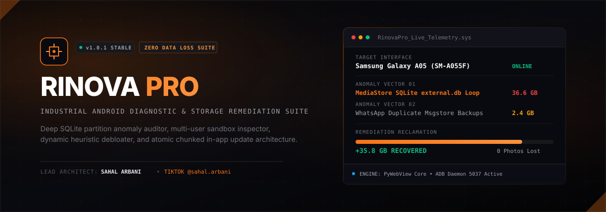

<p align="center">
  
</p>

<p align="center">
  <a href="https://github.com/arbdevai/rinova-pro/actions/workflows/build-windows.yml">
    
  </a>
  <a href="https://github.com/arbdevai/rinova-pro/releases/latest">
    
  </a>
  
  
  
</p>

---

## Ringkasan Eksekutif

**Rinova Pro** adalah aplikasi desktop diagnostik sistem Android tingkat industri yang dirancang khusus untuk teknisi reparasi smartphone, laboratorium pemulihan data, dan profesional *reverse engineering*. 

Aplikasi ini mengatasi anomali kritis pada perangkat modern (seperti kegagalan indeks SQLite MediaStore internal Android yang memicu pembengkakan database hingga puluhan gigabyte dan mengunci partisi `/data`), membersihkan tumpukan partisi usang secara terarah, dan menghapus *bloatware* pabrikan secara dinamis tanpa membahayakan data foto, video, dokumen, maupun basis data percakapan pengguna.

---

## Kasus Uji Nyata (Empirical Field Test)

Pada pengujian kasus nyata perangkat **Samsung Galaxy A05 (SM-A055F, Android 15)** milik pelanggan:
* **Kondisi Awal:** Partisi `/data` berkapasitas 48 GB terisi 100% (sisa ruang hanya 34 MB). Ponsel mengalami *system throttling*, freeze konstan, dan galeri gagal memuat foto.
* **Akar Masalah:** Database indeks `com.google.android.providers.media.module` (`/data/user/0/.../databases/external.db`) mengalami lonjakan ukuran abnormal hingga **36.6 GB** akibat loop transaksi WhatsApp dan ketiadaan auto-vacuum.
* **Solusi Rinova Pro:** Menjalankan vektor pemulihan terarah tanpa menghapus file fisik di `/sdcard/DCIM/` atau dokumen pengguna.
* **Hasil Akhir:** Berhasil memulihkan ruang kosong sebesar **~35.8 GB** dalam waktu kurang dari 60 detik, menurunkan beban CPU dari 36% menjadi <2%, dan mengembalikan responsivitas sistem secara permanen.

---

## Fitur & Vektor Diagnostik Inti

### 1. Multi-Vector Storage Diagnostics & Remediation Matrix
Sistem mengaudit sektor penyimpanan internal Android secara mendalam melalui 6 vektor diagnosis mandiri:

* **Vektor 01: MediaStore Database SQLite Bloat**  
  Mendeteksi anomali ukuran `external.db` pada penyedia media sistem. Menyediakan perbaikan aman melalui pembersihan status indeks modul dan pemancaran otomatis *broadcast* `MEDIA_SCANNER_SCAN_FILE` untuk mengindeks ulang media riil.
* **Vektor 02: Secondary User Profile & Sandbox Isolation**  
  Menginspeksi partisi multi-profil (`UserHandle 95`, `150`, `999` pada Samsung Secure Folder, Dual Messenger, maupun Xiaomi Ruang Kedua) yang kerap menyembunyikan konsumsi kuota penyimpanan ganda tanpa disadari pengguna.
* **Vektor 03: WhatsApp Redundant Backup Pruner**  
  Mengidentifikasi tumpukan arsip cadangan harian lokal (`msgstore-*.db.crypt*`). Menjaga file cadangan paling mutakhir dan menghapus arsip redundan lama secara otomatis.
* **Vektor 04: Recycle Bin & Thumbnail Purge**  
  Membersihkan tumpukan direktori tersembunyi `.Trash` pada vendor Android serta cache *thumbnail* usang di folder `DCIM/.thumbnails`.
* **Vektor 05: Telegram Streaming Media Cache**  
  Mendeteksi dan membersihkan cache *streaming* file video yang tersimpan di direktori aplikasi Telegram.
* **Vektor 06: DropBoxManager & Crash Dumps Purge**  
  Menghapus jejak log crash, *tombstones*, dan rekaman ANR sistem melalui perintah resmi AOSP `dumpsys dropbox --clear`.

### 2. Dynamic Heuristic Package Debloater
* **Zero Hardcoded Packages:** Tidak mengandalkan daftar paket statis yang kaku. Seluruh paket dibaca langsung dari perangkat via `pm list packages` (`-u` uninstalled, `-s` system, `-d` disabled).
* **Pola Heuristik Cerdas:** Mengklasifikasikan paket secara otomatis ke dalam kategori: *Adware & Promosi* (Glance, IronSource Aura), *Telemetri & Analitik Pabrikan* (DiagMon, Rubin), *Layanan Meta Background*, dan *Paket Bahasa TTS Non-Aktif*.
* **Batch Operations Berizin Aman:** Mendukung operasi massal Disable (`pm disable-user --user 0`), Enable, dan Reinstall/Uninstall dengan dialog konfirmasi keselamatan.

### 3. Industrial-Grade In-App Update Engine
Menerapkan standar ketahanan unduhan tingkat enterprise yang kebal terhadap jaringan lemah, *throttling*, maupun diskoneksi:
* **Isolasi File `.part`:** Seluruh proses pengunduhan ditulis ke file sementara `app-vX.X.X.zip.part`. File hanya di-rename menjadi `.zip` setelah 100% byte sukses terunduh dan lolos verifikasi.
* **Resumable HTTP Range Streaming:** Mendukung header `Range: bytes=X-` (`HTTP 206 Partial Content`). Jika unduhan terputus di tengah jalan, proses akan melanjutkan sisa byte yang belum terunduh tanpa mengulang dari 0%.
* **Buffer 64 KB & Generous Timeouts:** Menggunakan buffer *chunking* 64 KB dengan toleransi timeout soket 30 detik (koneksi) dan 60 detik (baca data).
* **Deep Archive Integrity Test (`zipfile.testzip()`):** Memverifikasi integritas checksum CRC32 setiap entri arsip ZIP sebelum mengizinkan proses ekstraksi.
* **Automated Batch Patcher:** Skrip `updater.bat` mengekstrak pembaruan secara atomik menggunakan PowerShell `Expand-Archive -Force` dan me-relaunch aplikasi secara mandiri.

### 4. Live Hardware Telemetry Sub-bar
Antarmuka terintegrasi yang memantau status fisik perangkat secara non-blocking:
* Deteksi Brand, Model, dan Kode Manufaktur.
* Deteksi Versi OS Android dan SDK API Level.
* Tingkat Patch Keamanan (*Security Patch Date*).
* Status Kapasitas Baterai dan Suhu Sensor Termal Perangkat.
* Mode Koneksi: `USB DIRECT` atau `WIRELESS ADB`.
* Proteksi Status `UNAUTHORIZED` dengan indikator visual dan instruksi dialog otorisasi RSA.

---

## Arsitektur Teknis

```
+-------------------------------------------------------------------+
|                        RINOVA PRO UI                              |
|           Tailwind CSS • Phosphor Icons • Inter & Mono            |
|                 (True Dark OLED #000000 Palette)                  |
+---------------------------------+---------------------------------+
                                  |
                   [PyWebView / IPC Bridge Interface]
                                  |
+---------------------------------v---------------------------------+
|                       CORE ENGINE (PYTHON)                        |
|                                                                   |
|   +--------------------+  +--------------------+  +-----------+   |
|   |   ADB Controller   |  |  Device Inspector  |  |  Storage  |   |
|   |  (Process & Safe)  |  |  (Specs & Battery) |  | Analyzer  |   |
|   +--------------------+  +--------------------+  +-----------+   |
|   +--------------------+  +--------------------+  +-----------+   |
|   | Storage Optimizer  |  | Dynamic Debloater  |  | In-App    |   |
|   | (Vector Handlers)  |  |  (Heuristic Rule)  |  | Updater   |   |
|   +--------------------+  +--------------------+  +-----------+   |
+---------------------------------+---------------------------------+
                                  |
                [ADB Client-Server Protocol (Port 5037)]
                                  |
+---------------------------------v---------------------------------+
|                         TARGET ANDROID                            |
|        Samsung One UI • Xiaomi HyperOS • Transsion • ColorOS      |
+-------------------------------------------------------------------+
```

---

## Persyaratan Sistem

* **Sistem Operasi:** Windows 10 (64-bit) / Windows 11 (64-bit)
* **Runtime:** Microsoft Edge WebView2 Runtime (sudah terpasang bawaan di Windows 10/11)
* **Konektivitas:** Port USB (disertai kabel data berkualitas) atau Jaringan WiFi lokal untuk Wireless ADB (Android 11+)
* **Konfigurasi HP:** Opsi Pengembang (Developer Options) aktif dengan USB Debugging diizinkan

---

## Petunjuk Penggunaan & Kompilasi

### 1. Menjalankan Portable Executable (Tanpa Instalasi)
1. Unduh rilis portabel resmi di halaman [GitHub Releases](https://github.com/arbdevai/rinova-pro/releases/latest).
2. Ekstrak file `RinovaPro-Windows-Portable.zip`.
3. Jalankan `RinovaPro.exe`.
4. Hubungkan ponsel melalui kabel USB dan izinkan dialog otorisasi USB Debugging pada layar perangkat.

### 2. Menjalankan Live Preview Server (Mode Pengembang)
Untuk pengujian modul antarmuka dan API secara lokal tanpa kompilasi binary:
```bash
cd rinova-pro
python3 preview_server.py 8080
```
Buka browser pada alamat `http://localhost:8080`.

### 3. Kompilasi Executable via GitHub Actions CI
Seluruh proses pembuatan binary didelegasikan secara otomatis ke infrastruktur kompilasi Microsoft Windows Server resmi melalui GitHub Actions:
1. Buat tag versi Git baru (mengikuti SemVer):
   ```bash
   git tag -a v1.0.X -m "Release v1.0.X: Deskripsi perubahan"
   git push origin v1.0.X
   ```
2. Workflow GitHub Actions akan secara otomatis mengompilasi binary dengan PyInstaller, menyatukan dependensi Google Platform-Tools resmi, dan mem-publish rilis publik beserta berkas `RinovaPro-Windows-Portable.zip`.

---

## Tim Pengembang & Kredit

**Lead Architect & Creator:**  
**Sahal Arbani**
* **Portofolio & Media:** [TikTok @sahal.arbani](https://www.tiktok.com/@sahal.arbani)
* **Spesialisasi:** Rekayasa Sistem, Reverse Engineering Android, dan Utilitas Diagnostik Hardware.

---

<p align="center">
  <sub>Rinova Pro dikembangkan secara independen untuk keperluan diagnostik teknisi profesional. Seluruh hak cipta dilindungi.</sub>
</p>
